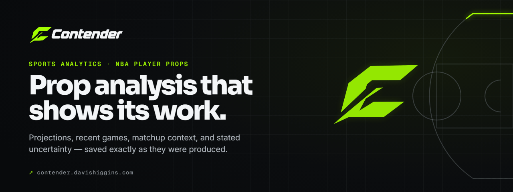
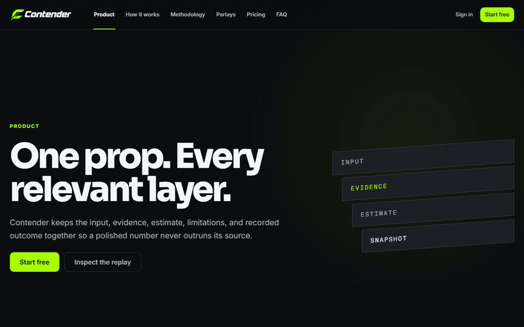
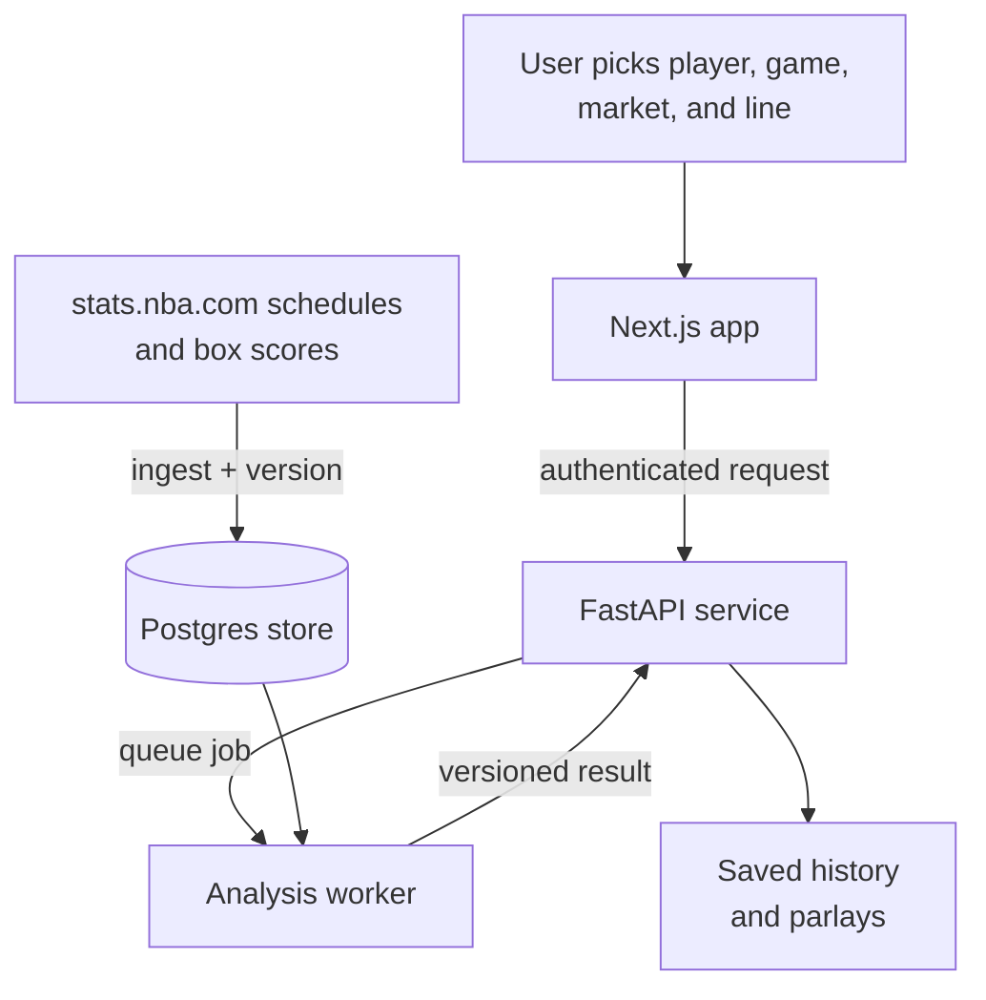
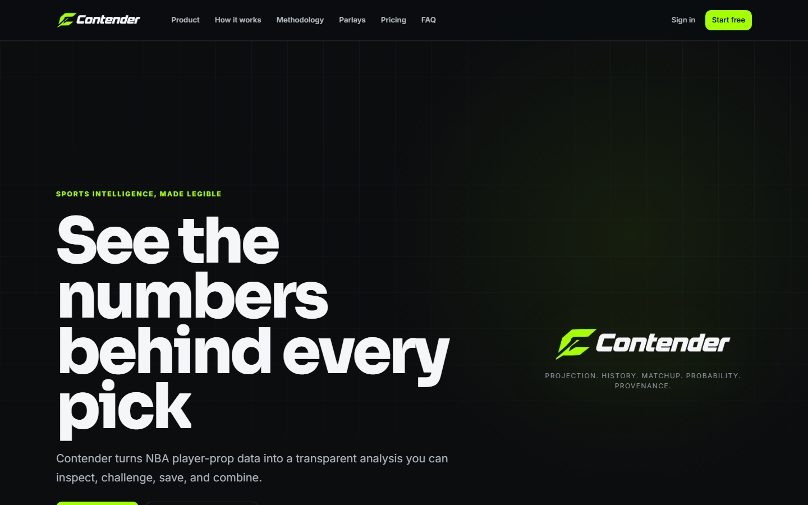
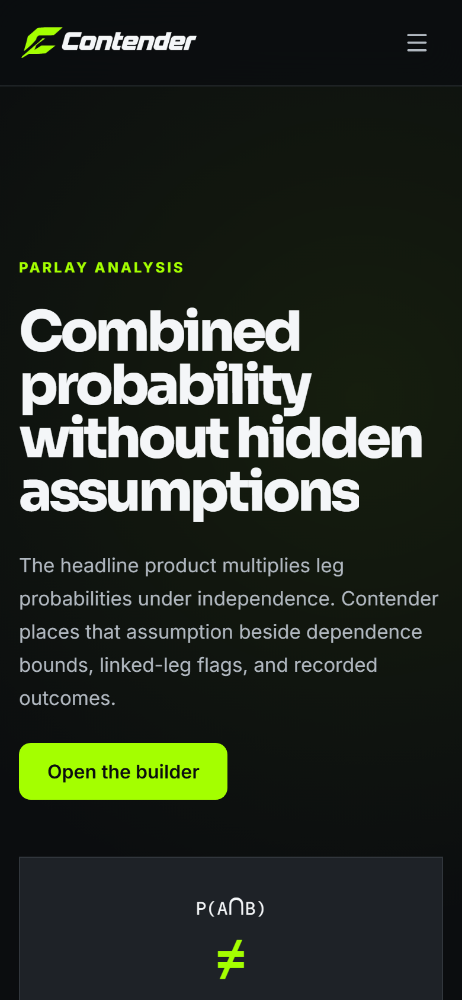
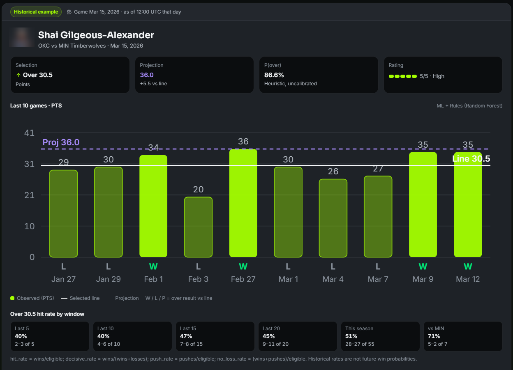

  

<h1 align="center">Contender</h1>

  <strong>NBA player-prop analysis that shows its work, keeps its evidence, and labels its limits.</strong> 
  <a href="https://contender.davishiggins.com"><strong>Open Contender ↗</strong></a> · <a href="https://www.higginsd.com/work/contender">Case study</a> · <a href="https://davishiggins.com">Davis Higgins</a>

Live product · NBA only · Built and maintained by Davis Higgins

---

## See it in motion

  

Real capture of the public product page at contender.davishiggins.com. The analysis shown is a historical replay graded after the game, not a live pick. Player photo blurred. <a href="assets/demo.png">Static frame</a>

## What it does

- **One prop, every relevant layer.** Pick a player from a canonical index, a scheduled game, and a market. Enter your own line. The result puts the projection, margin against the line, last ten games, hit rates by window, matchup context, reasons, and risks on one screen.
- **Results that don't drift.** Saved analyses are immutable snapshots. Reopening one shows exactly what Contender said, and historical replays are graded against stored box scores with misses left visible.
- **Parlays without hidden assumptions.** Two- to four-leg drafts show the independence estimate beside dependence bounds, flag same-game and contradictory legs, and keep a failed leg visible instead of quietly producing a total.

## Why I built it

Most prop tools hand over a pick and hide everything behind it. A bare number can't be checked, and when it misses there's no record of what the tool actually said. Probabilities make it worse: a precise-looking percentage reads like a guarantee even when the model behind it has never been calibrated.

I built Contender as an analysis tool rather than a pick service. Transparency is the product. Every number traces to a source, every estimate says what kind of estimate it is, and nothing gets quietly rewritten after the game.

## What I built

I designed and built Contender end to end. It started as Propify, my earlier NBA analytics project, and became a full rebuild.

- Product and visual design, including the marketing site, analyzer, history, and parlay builder
- The data pipeline that ingests and versions NBA schedules and box scores
- The analysis engine, job system, and background worker
- Accounts, a usage-based free tier, and billing
- The methodology pages that define each metric in plain language

## How it works

The web app never computes analyses in the browser. It sends an authenticated request, the API queues a job, and a worker builds the result from data Contender has already ingested and versioned. Finished results come back as complete, versioned envelopes that can be saved and reopened.

### Engineering decisions

| Decision | Why |
|---|---|
| **Store every fetch, version every result** | Box scores are ingested and kept as snapshots, and each analysis records the data and engine version it used. A replay "as of game day" cannot see games that happened afterward, and an old result is never recomputed against newer data. |
| **Label probability by what it is** | Every probability carries a calibration status. A trained model only replaces the rules-based path after it beats that path in walk-forward validation, and the UI never calls an estimate calibrated unless the calibration report supports it. |
| **Bounds instead of a false joint probability** | Parlay legs are rarely independent. Contender shows the independence estimate alongside Fréchet bounds and dependency flags, and states that a joint same-game model isn't shipped yet instead of inventing one. |

Retries reuse the original idempotency key, so a flaky connection can't double-charge a user's daily analyses. Signed-in requests are verified on the server against the identity provider's signing keys.

## Screens

<table>
  <tr>
    <td width="62%"></td>
    <td rowspan="2" width="38%" align="center"></td>
  </tr>
  <tr>
    <td></td>
  </tr>
</table>

Homepage · Historical replay with evidence (player photo blurred) · Parlay analysis on mobile

## Technology

| Layer | Technology | Responsibility |
|---|---|---|
| Web app | Next.js 16 (App Router), TypeScript, Tailwind CSS v4 | Marketing site, analyzer, history, parlay builder |
| API & worker | Python 3.11, FastAPI | Versioned API, job lifecycle, ingestion, settlement |
| Analysis | scikit-learn | Rules-plus-empirical baseline and optional trained models behind a validation gate |
| Data | Supabase (Postgres) | Ingested NBA data, saved analyses, usage, with row-level security on every table |
| Accounts & billing | Clerk, Stripe | Sign-in and session tokens; subscriptions |
| Hosting | Vercel (web), Render (API) | Production deployment |

## Validation and limits

- **Tested.** The dated launch record from September 2026 shows 648 backend tests and 125 frontend tests passing, plus type, lint, build, and API-contract checks. That covers market math for every supported market, as-of data integrity, job lifecycle, and ownership rules. Those are offline checks. The record still lists some live gates, such as real-data multi-leg parlay runs, as not yet recorded.
- **Uncalibrated, and labeled that way.** In the recorded promotion check, the rules-based path beat the trained points model, so probabilities remain marked as uncalibrated estimates.
- **NBA only.** Groundwork for other sports exists but ships disabled. Nothing here is MLB or NFL functionality.
- **Not betting advice.** Contender doesn't accept wagers and isn't affiliated with or endorsed by the NBA. Responsible-gaming resources are linked on every page.

## About this repository

This is a documentation-only showcase. Contender's application code, data, model artifacts, and configuration are private and aren't included here.

**[Open Contender ↗](https://contender.davishiggins.com)** · Built by [Davis Higgins](https://davishiggins.com) · [More of my work](https://github.com/DavisHiggins)

© 2026 Davis Higgins. Text and images in this repository are shared for portfolio viewing. Contender and its logo belong to Davis Higgins. NBA team and player names are used descriptively.
