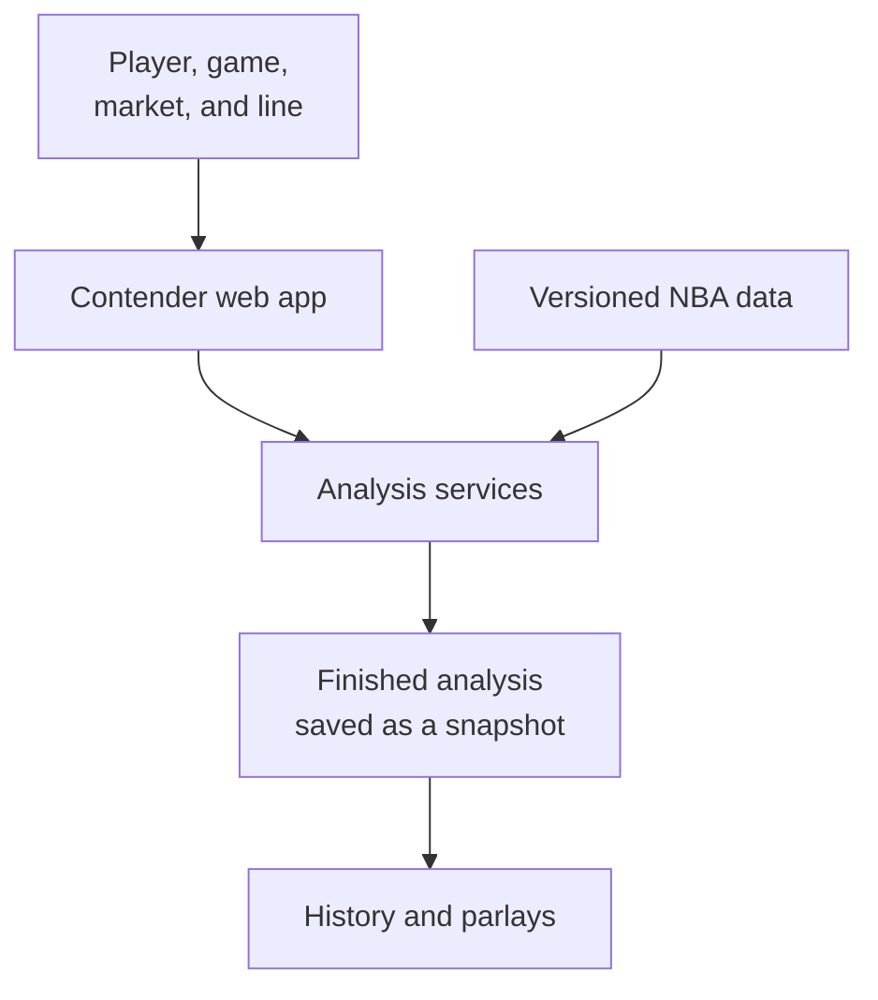

  

<h1 align="center">Contender</h1>

<strong>NBA player-prop analysis that shows its work and keeps its evidence.</strong>

  &nbsp;
  &nbsp;
  

Live product · NBA · Designed and built by Davis Higgins

---

## See it in motion

  

Real capture of the public product page at contender.davishiggins.com. Player photo blurred. <a href="assets/demo.png">Static frame</a>

## What it does

- **One prop, every relevant layer.** Pick a player, a scheduled game, and a market, then enter your own line. The projection, margin against the line, recent form, hit rates, matchup context, reasons, and risks all land on one screen.
- **Results that don't drift.** Every saved analysis is a snapshot. Reopen one and you see exactly what Contender said, and historical replays are graded with misses left visible.
- **Parlays without hidden assumptions.** Build two- to four-leg parlays, see a combined view of the legs, and get flagged when legs depend on each other or contradict one another.

## Why I built it

Most prop tools hand over a pick and hide everything behind it. A bare number can't be checked, and when it misses there's no record of what the tool actually said.

I built Contender as an analysis tool rather than a pick service. Transparency is the product: every number traces to its source, every estimate says what kind of estimate it is, and nothing gets quietly rewritten after the game.

## What I built

I designed and built Contender end to end. It grew out of Propify, my earlier NBA analytics project, into a full rebuild.

- Product and visual design across the marketing site, analyzer, history, and parlay builder
- The data platform that collects and versions NBA schedules and results
- The analysis engine and the services that run it
- Accounts, plans, and billing
- Methodology pages that explain every metric in plain language

<strong>How it's put together</strong>

 

| Decision | Why |
|---|---|
| **Every result is a snapshot** | An analysis is saved exactly as it was produced, along with the data behind it. Old results are never silently recomputed, and a replay can't see games that happened later. |
| **Every number says what it is** | Observed stats, projections, and estimates are labeled differently, so users always know how much weight a number deserves. |
| **Analysis stays on the server** | The browser only shows finished results. Requests are authenticated, and usage is counted fairly even when a connection retries. |

## Screens

<table>
  <tr>
    <td width="62%"></td>
    <td rowspan="2" width="38%" align="center"></td>
  </tr>
  <tr>
    <td></td>
  </tr>
</table>

Homepage · Historical replay with evidence (player photo blurred) · Parlay analysis on mobile

## Technology

| Layer | Technology |
|---|---|
| Web app | Next.js, TypeScript, Tailwind CSS |
| Services | Python |
| Data | Postgres (Supabase) |
| Accounts and billing | Clerk, Stripe |
| Hosting | Vercel |

---

  &nbsp;
  

© 2026 Davis Higgins. All rights reserved. Contender and its logo belong to Davis Higgins. NBA team and player names are used descriptively.

